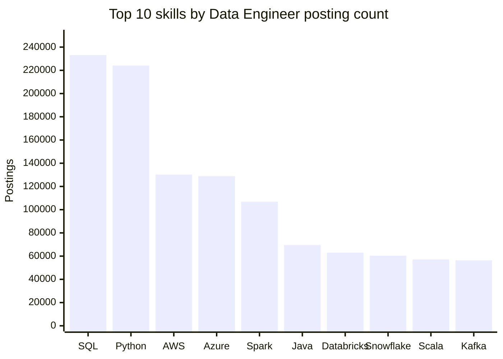
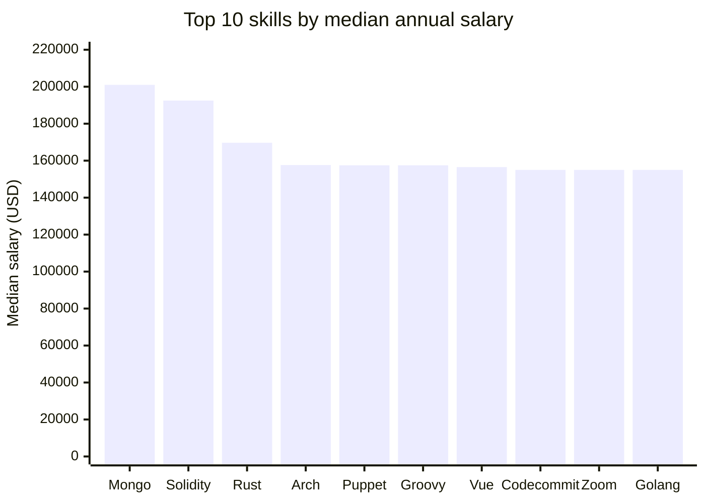
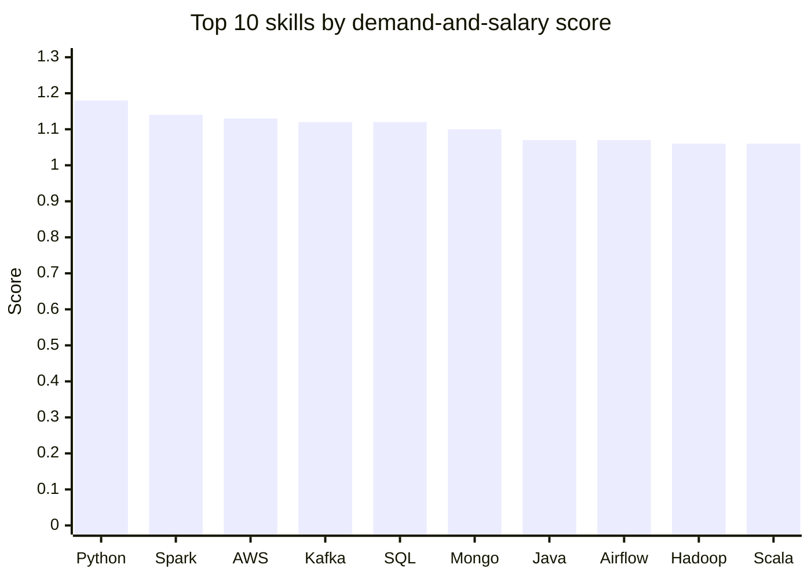

# Data Engineer Job Market: Exploratory Data Analysis

This folder contains three SQL analyses of skills associated with Data Engineer
job postings. Together, they look at skill demand, median salary, and a
demand-and-salary score.

## Analyses

| File | Question | Main output |
| --- | --- | --- |
| [01_top_demanded_skills.sql](./01_top_demanded_skills.sql) | Which skills appear most often in Data Engineer postings? | Top 10 skills by posting count |
| [02_top_payingSkill.sql](./02_top_payingSkill.sql) | Which skills are associated with the highest median salaries? | Top 20 skills by median annual salary, with more than 100 associated postings |
| [03_top_optimisedSkill.sql](./03_top_optimisedSkill.sql) | Which skills combine salary and demand? | Top 20 skills by the analysis's combined score |

## Findings

- **SQL and Python lead in demand**, appearing in 233,132 and 224,102 postings,
  respectively, in the first query's results.
- **Mongo has the highest median salary** in the paying-skills results at
  $201,000. Some other high-paying skills have much smaller counts, so the
  query's minimum-count threshold matters when interpreting the ranking.
- **Python ranks first on the combined score** (1.18), followed by Spark (1.14)
  and AWS (1.13). This favors skills that have both strong salary and broad
  demand.

## Charts

### Most demanded skills

### Highest median salaries

### Highest combined scores

## Method and interpretation

Each query joins `job_postings_fact` to `skills_job_dim` and `skills_dim`, and
filters for `job_title_short = 'Data Engineer'`.

- **Demand** is the number of job-skill associations returned by the query. A
  posting requiring several skills contributes to each of those skills.
- The paying-skills query uses `MEDIAN(salary_year_avg)` and retains skills
  with more than 100 associated postings. The median ignores null salary
  values; its `demand_count` counts joined postings, not just postings with a
  reported salary.
- The optimized-skills query excludes rows with a null annual salary and
  requires more than 100 salary observations. Its count therefore differs from
  the demand count in the paying-skills query.
- The combined score is calculated in the SQL as
  `median_salary * ln(demand_count) / 1,000,000`, rounded to two decimal
  places. It is a project-specific comparison metric, not a standardized
  measure.
- Although the first query's comment mentions remote postings, its SQL does
  **not** filter for remote jobs. Its results cover all matching postings in
  the available data.

The figures above reproduce the result tables embedded in the SQL files. They
will need updating if the queries are rerun against a changed dataset.

## Running the queries

Run the SQL files in a DuckDB environment with the job-postings schema
(`job_postings_fact`, `skills_job_dim`, and `skills_dim`) loaded. The project
also includes a DuckDB database at [`../lessonsSQL/jobs.duckdb`](../lessonsSQL/jobs.duckdb).